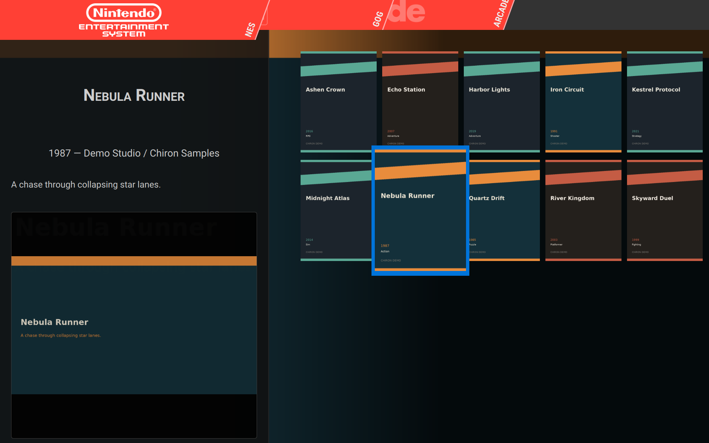

# Chiron

**Chiron is a Linux game library frontend.** Browse your collection and launch emulators, native games, and GOG titles—including Windows/Proton installs from Heroic or Dark1HGL—from one AppImage.

[Download](https://github.com/dark1ltg/Chiron/releases/latest) · [Changelog](CHANGELOG.md)

A focused GPLv3 fork of [Pegasus Frontend](https://github.com/mmatyas/pegasus-frontend). Themes stay compatible; Chiron ships **Linux x86_64 AppImage only**, with GOG discovery fixed for Heroic-style installs.

## Screenshots




## Highlights

- Couch-friendly library UI (Pegasus-compatible themes)
- Emulators and multi-source libraries
- GOG via Heroic / Dark1HGL (any install path, including Proton) plus native `~/GOG Games`
- Config under `~/.config/chiron`

## Install

```sh
chmod +x Chiron-*-x86_64.AppImage
./Chiron-*-x86_64.AppImage
```

Grab the AppImage from [Releases](https://github.com/dark1ltg/Chiron/releases/latest).

## GOG

Reads `~/GOG Games` and Heroic/Dark1HGL `gog_store/installed.json`, then launches with `heroic://launch/gog/<appName>` (PATH, desktop entry, common AppImage dirs, or Flatpak). From **0.2.1**, launches strip AppImage library overrides for both native and Heroic titles, Flatpak vs native helpers follow the config they came from, and duplicate / missing installs are handled more carefully.

```
providers.gog.directories: /path/to/extra/gog/root
providers.gog.launch_helper: /path/to/Dark1HGL.AppImage
```

## Themes (Pegasus-compatible)

The AppImage is read-only — do **not** put themes inside it, and do **not** use `~/.config/pegasus-frontend/…` (that’s upstream). Chiron loads themes from:

```text
~/.config/chiron/themes/<ThemeName>/
├── theme.cfg
└── theme.qml
```

1. Download a [Pegasus theme](https://pegasus-frontend.org/themes/)
2. Extract so `theme.qml` sits directly in that theme folder (no extra nesting)
3. `mkdir -p ~/.config/chiron/themes && mv /path/to/ThemeName ~/.config/chiron/themes/`
4. Restart Chiron → **Settings → Theme** → select it

Already have Pegasus themes installed? Symlink instead of copying:

```sh
mkdir -p ~/.config/chiron/themes
ln -s ~/.config/pegasus-frontend/themes/SomeTheme ~/.config/chiron/themes/SomeTheme
```

## Build

```sh
VERSION=0.2.2 ./scripts/build-appimage.sh   # → dist/Chiron-*-x86_64.AppImage
```

From source: `git submodule update --init && cmake -B build && cmake --build build` (Qt 5.15+, SDL2). CI builds on tag push / `workflow_dispatch` via [`.github/workflows/release-appimage.yml`](.github/workflows/release-appimage.yml).

## License

GPLv3 — see [LICENSE.md](LICENSE.md). Not affiliated with Pegasus Frontend or GOG.
