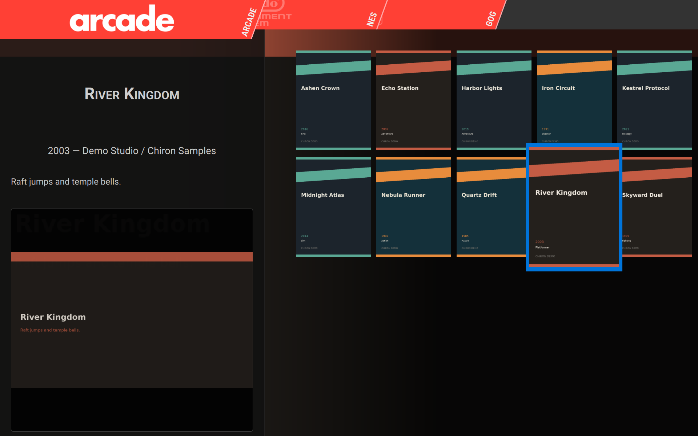
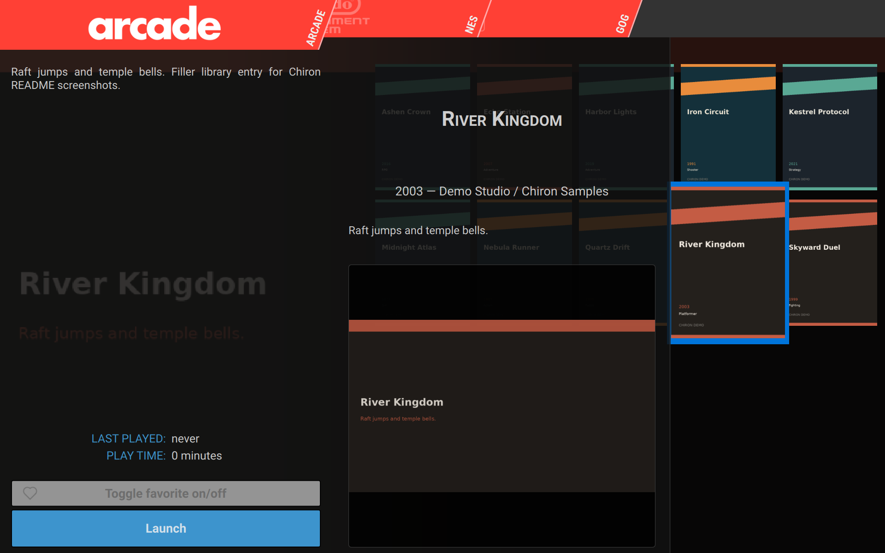

# Chiron

**Chiron is a Linux game library frontend.** One AppImage to browse your collection and launch emulators, native games, and GOG titles—including Windows/Proton installs managed by Heroic or Dark1HGL.

Homepage / source: [github.com/dark1ltg/Chiron](https://github.com/dark1ltg/Chiron)  
Latest release: [Releases](https://github.com/dark1ltg/Chiron/releases)

Chiron is a focused GPLv3 fork of [Pegasus Frontend](https://github.com/mmatyas/pegasus-frontend). Themes and library providers remain compatible; **this project ships only a Linux x86_64 AppImage**, with Linux GOG discovery fixed for Heroic-style installs.

## Screenshots

Real Chiron UI (default theme) with a filler demo library:






## What you get

- Couch-friendly game library browser and launcher
- Emulator and multi-source library support (Pegasus-compatible themes and metadata)
- **GOG on Linux that finds Heroic / Dark1HGL games** (any install path / drive) and launches them through Heroic so Proton works
- Native `~/GOG Games` + `start.sh` installs still work
- Single downloadable AppImage — no Flatpak / deb / rpm / Windows / macOS release from this project

## Who it’s for

Linux players who already use Heroic or Dark1HGL for GOG (especially Proton/Windows builds) and want a themable frontend without missing GOG imports.

## Supported release

| Platform | Status |
|---|---|
| Linux x86_64 AppImage | **Supported** — see [Releases](https://github.com/dark1ltg/Chiron/releases) |
| Windows / macOS / Android / Flatpak / deb / rpm | Not supported / not shipped |

Upstream multi-platform code may still exist in the tree; do not expect builds or docs for those targets from Chiron.

## Install

1. Download `Chiron-*-x86_64.AppImage` from the [latest release](https://github.com/dark1ltg/Chiron/releases/latest)
2. Make it executable and run:

```sh
chmod +x Chiron-*-x86_64.AppImage
./Chiron-*-x86_64.AppImage
```

Config and cache live under the `chiron` application name (for example `~/.config/chiron`, `~/.cache/chiron`).

## GOG on Linux

Chiron’s GOG provider will:

- Scan `~/GOG Games` (and `providers.gog.directories`) for native `start.sh` games
- Read Heroic / Dark1HGL `gog_store/installed.json` (any `install_path`, including other drives)
- Launch Heroic-managed titles headlessly, for example:  
  `env -u LD_LIBRARY_PATH … <heroic> --no-gui heroic://launch/gog/<appName>`

Optional settings:

```
providers.gog.directories: /path/to/extra/gog/root
providers.gog.launch_helper: /path/to/Dark1HGL.AppImage
```

`launch_helper` is recommended for Dark1HGL/Heroic AppImages. Chiron also searches PATH, `*.desktop` files, and common AppImage folders (`~/Applications`, `~/AppImages`, …), then Flatpak. Launches strip AppImage library overrides so Proton gets a clean host environment.

GOG store metadata (art, description, genres) uses the public GOG product APIs, keyed by GOG ID, cached under `~/.cache/chiron/gog/`.

## Changelog

See [CHANGELOG.md](CHANGELOG.md) for release notes. Current version: **0.2.0**.

## Build the AppImage

```sh
./scripts/build-appimage.sh
# → dist/Chiron-<version>-x86_64.AppImage
```

Optional: `VERSION=0.2.0 ./scripts/build-appimage.sh`

The script downloads a static Qt 5.15.12 + SDL2 toolchain into `/opt` (same upstream tool archives Pegasus uses for Linux builds).

GitHub Actions workflow [`.github/workflows/release-appimage.yml`](.github/workflows/release-appimage.yml) builds the AppImage on tag push (`v*` / `chiron-*`), on `workflow_dispatch`, or when [`.github/release-request`](.github/release-request) is updated, and attaches it to a GitHub Release.

## Building from source

Dependencies: Qt 5.15+ (QML, Multimedia, SVG, SQL/SQLite), plus SDL2 or Qt Gamepad.

```sh
git submodule update --init
mkdir build && cd build
cmake ..
cmake --build .
```

## License

GPLv3. See [LICENSE.md](LICENSE.md).

Chiron is not affiliated with Pegasus Frontend or GOG. “Pegasus” and related marks belong to their respective owners; this fork is renamed under GPLv3 §7.
